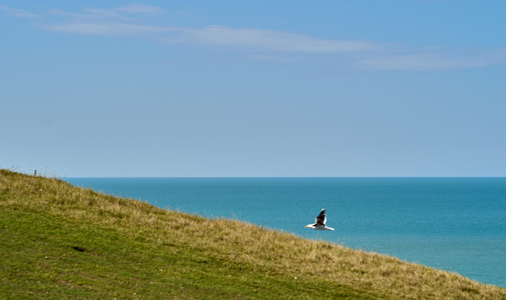

_Kopieer en plak hier jouw README.md uit sprint 1._

# Learning Log Mats van Waarden

9 nov - Kickoff

### Wat heb ik vandaag gedaan:

Een fork van de model repository gemaakt en gepubliceerd via mijn eigen Github omgeving (binnen een eigen domein).

### Checkout vragen:

#### 1. _Leg uit wat een source hosting platform is en voor welke jij gekozen hebt._

> Een source hosting platform is een platform waarop developers (samen) code kunnen opslaan, delen en bewerken. Ik heb gekozen voor github, omdat we hier bij wijzer op het web al een klein beetje gebruik van hebben gemaakt, en dit voor zover ik weet de industriestandaard is.

#### 2. _Vertel welke domeinnaam jij gekozen hebt en hoe je die hebt gekoppeld aan jouw pagina._

> Ik heb gekozen voor de domeinnaam: "hettuintjevanmats.nl" ik vond dit een toepasselijke twist op het doel van de opdracht, het maken van een digital garden, en heb zo vrij snel mijn keuze gemaakt. Na het domein op te kopen via Trans-IP, heb ik de DNS records aangepast om het domein aan mijn github repository te linken / ernaar te verwijzen, en heb ik het domein via de instellingen van de repository (om specifiek te zijn; Github Pages) gekoppeld.

#### 3. _Beschrijf hoe je aanpassingen aan jouw pagina kunt maken en hoe je er voor zorgt dat die op het web gepubliceerd worden._

> Ik kan aanpassingen maken door in mijn Visual Studio Code de codebestanden die in de door de docent gemaakte template meegeleverd zijn te bewerken. Voor nu is dat voornamelijk de index.html, waarin simpele html aanpassingen gemaakt kunnen worden door code te schrijven of te bewerken. Na het uitvoeren van wijzigingen, kan ik via source control deze wijzigingen "committen" naar mijn github repository. Vervolgens sync ik deze wijzigingen in hetzelfde scherm en zullen deze in de bestanden in de repository aangepast worden. Dit is ook wat ik ga doen om deze tekst op mijn pagina te krijgen :)

11 nov - practica

### Wat heb ik vandaag gedaan:

##### In het eerste practicum;

Een herhaling gehad van MMD (Multi Modal Design), microinteracties / animaties en (nieuwe) informatie over forms. Dit was een nuttige geheugensteun, omdat het meeste van vorig jaar toch al wel een beetje was weggezakt.

##### In het tweede practicum;

Schetstechnieken, we hebben onder andere naar schetsen van vorig jaar gekeken om vast te stellen wat een schets "goed" maakt. Ook hebben we zelf geoefend met schetsen maken gebruikmakende van deze technieken. Om er een paar te noemen: Visuele hierarchie (door middel van fineline + dikkere stift), shading (met bijvoorbeeld een grijze stift), annotaties (met een andere kleur) en hoe je interactie / animatie zichtbaar maakt in een schets (met stippellijnen en een andere kleur bijvoorbeeld). Hieronder zijn de oefeningen te zien die we uitgevoerd hebben:

