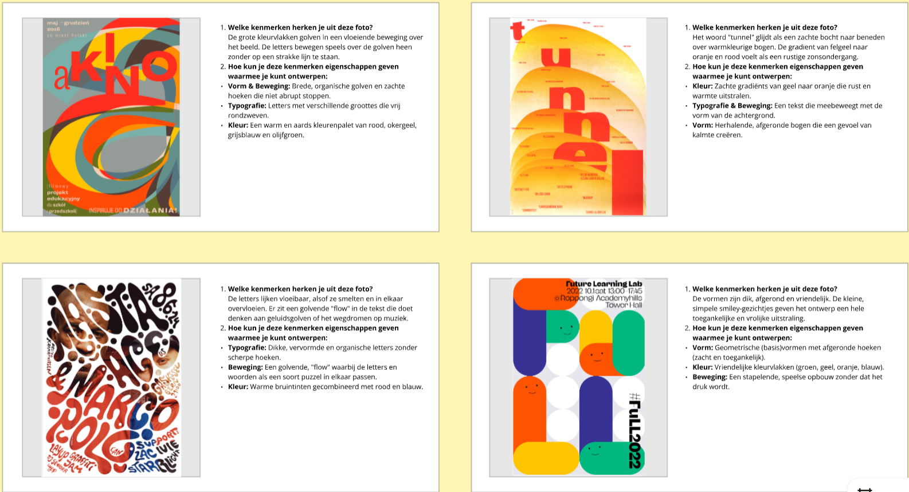
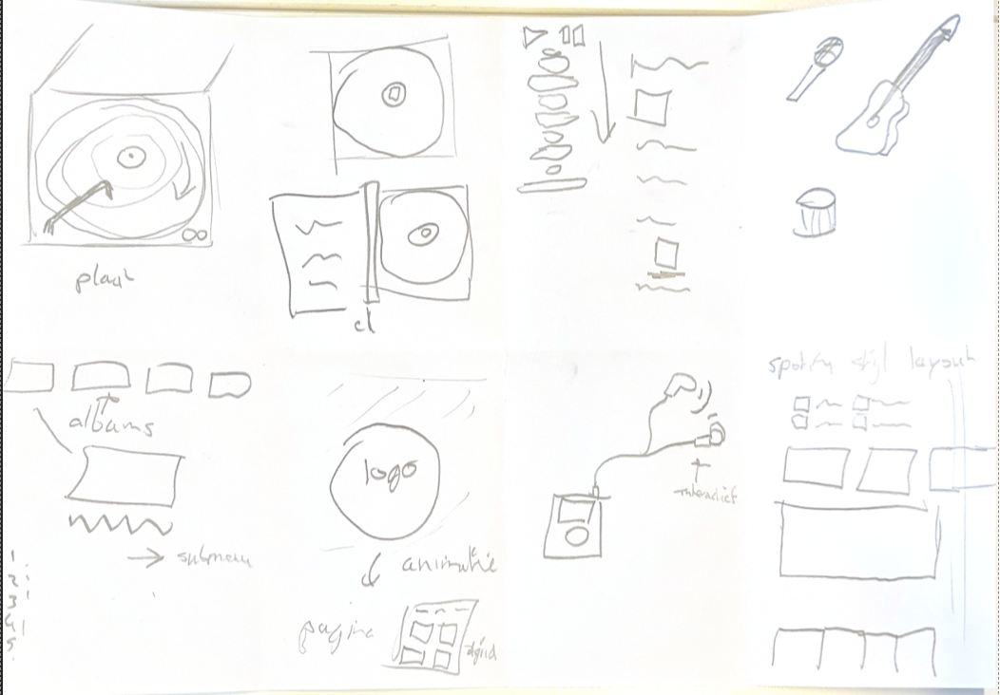
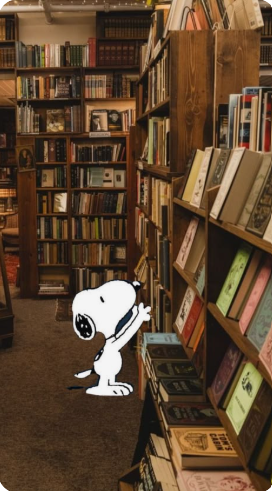
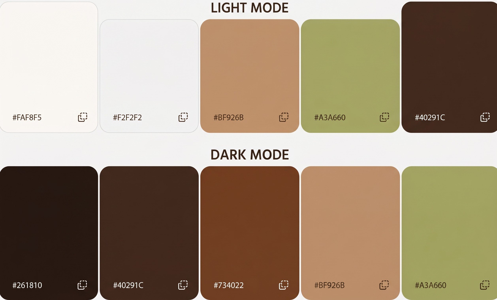
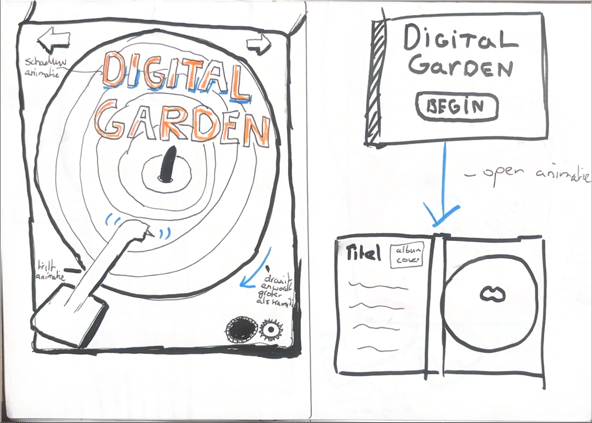
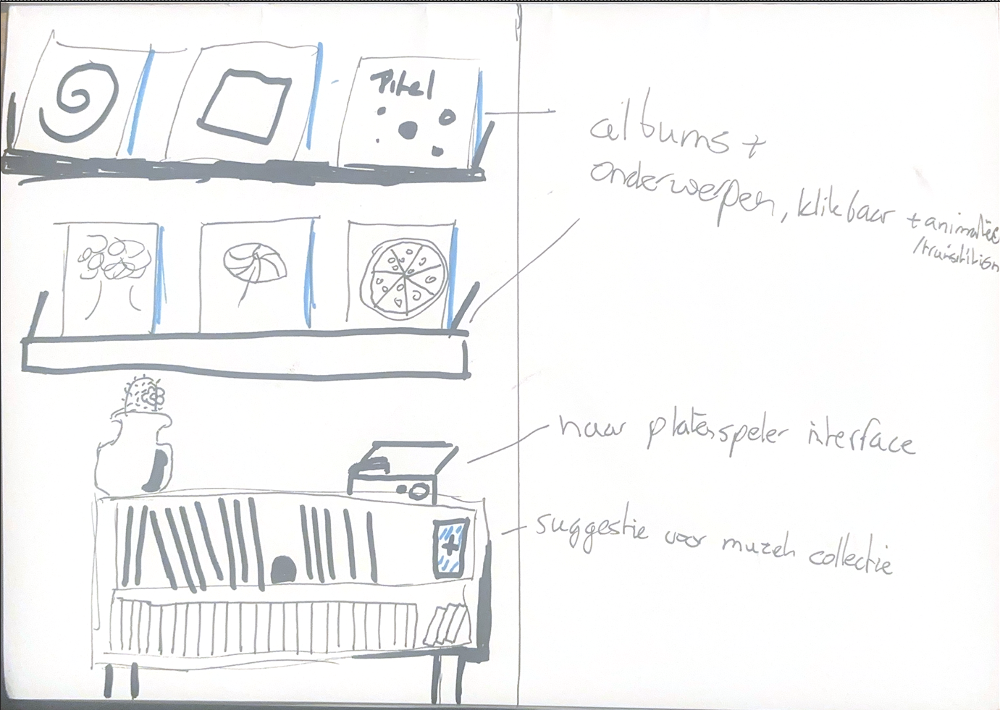
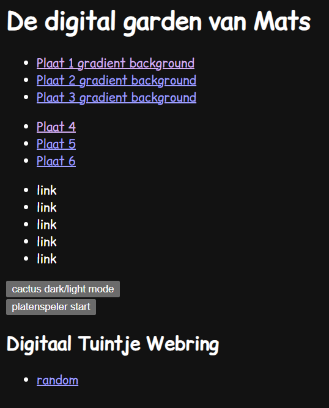
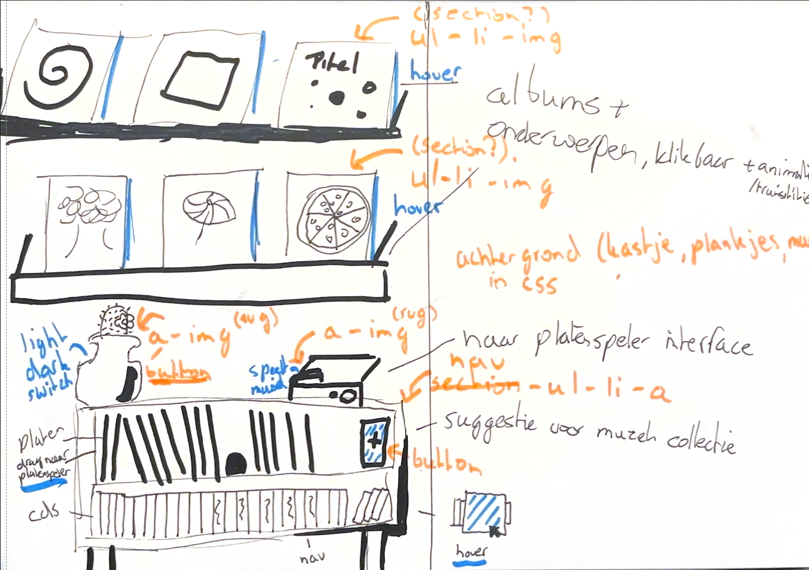
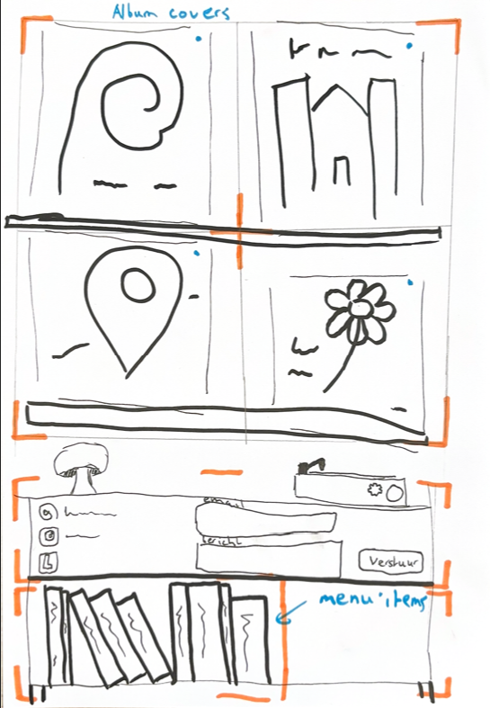

# Learning Log Mats van Waarden

<!-- 9 Nov Kickoff -->

<details>
<summary>9 nov - Kickoff</summary>

### Wat heb ik vandaag gedaan:

Een fork van de model repository gemaakt en gepubliceerd via mijn eigen Github omgeving (binnen een eigen domein).

### Checkout vragen:

#### 1. _Leg uit wat een source hosting platform is en voor welke jij gekozen hebt._

> Een source hosting platform is een platform waarop developers (samen) code kunnen opslaan, delen en bewerken. Ik heb gekozen voor github, omdat we hier bij wijzer op het web al een klein beetje gebruik van hebben gemaakt, en dit voor zover ik weet de industriestandaard is.

#### 2. _Vertel welke domeinnaam jij gekozen hebt en hoe je die hebt gekoppeld aan jouw pagina._

> Ik heb gekozen voor de domeinnaam: "hettuintjevanmats.nl" ik vond dit een toepasselijke twist op het doel van de opdracht, het maken van een digital garden, en heb zo vrij snel mijn keuze gemaakt. Na het domein op te kopen via Trans-IP, heb ik de DNS records aangepast om het domein aan mijn github repository te linken / ernaar te verwijzen, en heb ik het domein via de instellingen van de repository (om specifiek te zijn; Github Pages) gekoppeld.

#### 3. _Beschrijf hoe je aanpassingen aan jouw pagina kunt maken en hoe je er voor zorgt dat die op het web gepubliceerd worden._

> Ik kan aanpassingen maken door in mijn Visual Studio Code de codebestanden die in de door de docent gemaakte template meegeleverd zijn te bewerken. Voor nu is dat voornamelijk de index.html, waarin simpele html aanpassingen gemaakt kunnen worden door code te schrijven of te bewerken. Na het uitvoeren van wijzigingen, kan ik via source control deze wijzigingen "committen" naar mijn github repository. Vervolgens sync ik deze wijzigingen in hetzelfde scherm en zullen deze in de bestanden in de repository aangepast worden. Dit is ook wat ik ga doen om deze tekst op mijn pagina te krijgen :)

</details>

<!-- 11 Nov practica -->

<details>
<summary>11 nov - practica</summary>

### Wat heb ik vandaag gedaan:

##### In het eerste practicum;

Een herhaling gehad van MMD (Multi Modal Design), microinteracties / animaties en (nieuwe) informatie over forms. Dit was een nuttige geheugensteun, omdat het meeste van vorig jaar toch al wel een beetje was weggezakt.

##### In het tweede practicum;

Schetstechnieken, we hebben onder andere naar schetsen van vorig jaar gekeken om vast te stellen wat een schets "goed" maakt. Ook hebben we zelf geoefend met schetsen maken gebruikmakende van deze technieken. Om er een paar te noemen: Visuele hierarchie (door middel van fineline + dikkere stift), shading (met bijvoorbeeld een grijze stift), annotaties (met een andere kleur) en hoe je interactie / animatie zichtbaar maakt in een schets (met stippellijnen en een andere kleur bijvoorbeeld). Hieronder zijn de oefeningen te zien die we uitgevoerd hebben:


</details>

<!-- 13 Nov practica -->

<details>
<summary>13 nov - practica</summary>

### Wat heb ik vandaag gedaan:

#### In het eerste practicum (Praktische CSS);

In dit practicum zijn we begonnen met het maken van een "lelijke html" pagina. Deze hebben we vervolgens gebruikt om weer wat css kennis naar boven te halen. Zo zijn we aan de slag gegaan met fonts, plaatjes juist weergeven (met behulp van max-width), buttons en hun interactie, consistente witruimtest en een form / formulier. Het meeste hiervan (behalve de form), was bekende informatie (alhoewel dit wel al een tijd geleden was), maar ik heb ook wat nieuws geleerd. Door het gebruiken van variabelen kun je makkelijk door op 1 plek in de code een regel aan te passen op verschillende plekken de waarde veranderen. Dit scheelt een hoop gedoe, en maakt het een stuk makkelijker om snel grote wijzigingen door te voeren.

###### Plaatje


#### In het tweede practicum (CSS - Fonts met kleur en effecten);

Vervolgens zijn we verder gegaan met fonts, en ook meerdere soorten kleur en effecten. Er waren verschillende (na te maken) ontwerpen waar uit gekozen kon worden. Ik heb, naast de basisopdrachten, gekozen voor een opdracht uit de categorie "goed te doen" (neon), een uit "wellicht lastiger" (PUFF) en een uit "best tricky" (Messi). De eerste twee gingen mij met een beetje pielen redelijk af, maar met de laatste had ik echt moeite. Dit is mij uiteindelijk ook niet helemaal gelukt, maar ik zat wel in de juiste richting. Na een uitleg van Sanne had ik een stuk beter inzicht hoe deze laatste werkte, dus dat was erg fijn. Als laatste hebben we nog wat geleerd over animaties/transitions (transition: .5s; bijvoorbeeld), dit werkt perfect om bijvoorbeeld een knop bij :hover mooi naar een andere kleur te laten faden. Dit is ook erg handing voor in mijn uiteindelijke app. Mijn uitwerking en code is hieronder te zien:

###### Plaatje


###### CSS

```css
/**\*\***\*\***\*\***/
/_ @FONT-FACE _/
/**\*\***\*\***\*\***/
/_ Neon,Puff,Messi _/

/_ alle fonts hier _/
@font-face {
font-family: "Ubuntu";
src: url("../fonts/Ubuntu-Bold.ttf");
font-weight: 700;
}

@font-face {
font-family: "DynaPuff";
src: url("../fonts/DynaPuff-Bold.ttf");
font-weight: 700;
}

@font-face {
font-family: "Aldrich";
src: url("../fonts/Aldrich-Regular.ttf");
font-weight: 400;
}

/**\*\***\*\***\*\***\***\*\***\*\***\*\***/
/_ JOUW CODE VOOR DE BLOKJES _/
/**\*\***\*\***\*\***\***\*\***\*\***\*\***/

/_ met deze selector selecteer je de eerste li _/
li:nth-of-type(1) {
display: grid;
place-items: center;
background: linear-gradient(limegreen, midnightblue);

/_ je kunt css selectors nesten _/
/_ zo kun je makkelijker zien wat bij elkaar hoort _/
/_ met deze selector selecteer je de h2 in de eerste li _/
h2 {
font-size: 3.5rem;
color: rgb(0, 0, 0, 0);
-webkit-text-stroke-color: white;
-webkit-text-stroke-width: 1px;
}
}

/_ met deze selector selecteer je de tweede li _/
li:nth-of-type(2) {
background: radial-gradient(Yellow, Limegreen);
display: grid;
place-items: center;

h2 {
font-size: 4rem;
font-family: DynaPuff;
text-transform: uppercase;
color: white;
-webkit-text-stroke-width: 30px;
-webkit-text-stroke-color: limegreen;
paint-order: stroke fill;
}
}

li:nth-of-type(3) {
background: repeating-linear-gradient(
45deg,
rgb(0 100% 0 / 0.2),
rgb(0 100% 0 / 0.2) 130px,
green 130px,
green 260px
), repeating-linear-gradient(
45deg,
green,
green 130px,
rgb(0 100% 0 / 0.2) 130px,
rgb(0 100% 0 / 0.2) 260px,
)
display: grid;
place-items: top;

h2 {
color: white;
border: solid;
border-color: #fff;
font-size: 2rem;
font-family: Aldrich;
height: 80%;
margin: 2rem;
padding: 1.5rem;
padding-right: 6rem;
}
}
```

</details>

<!-- 16 Nov Kickoff Sprint 1 -->
<!-- 16 Nov Kickoff Sprint 1 -->
<!-- 16 Nov Kickoff Sprint 1 -->
<!-- 16 Nov Kickoff Sprint 1 -->
<!-- 16 Nov Kickoff Sprint 1 -->
<!-- 16 Nov Kickoff Sprint 1 -->
<!-- 16 Nov Kickoff Sprint 1 -->
<!-- 16 Nov Kickoff Sprint 1 -->
<!-- 16 Nov Kickoff Sprint 1 -->

<details>
<summary>16 nov - Kickoff Sprint 1</summary>

### Wat heb ik vandaag gedaan:

We zijn over de sprintplanning voor de eerste sprint heengegaan. Hierbij hebben we een lijst gemaakt van het huiswerk en de tussentijdse opdrachten die we afgerond moeten hebben voor de retrospect volgende week vrijdag. Vervolgens hebben we teksten/artikels gelezen over digital gardens, wat ons een goed beeld heeft gegeven over wat een digital garden inhoudt, en dit heeft mij ook enorm geholpen met mijn beeld van de opdracht over de komende weken. Hierna hebben we naar wat webrings gekeken, en deze vergeleken aan de hand van verschillende criteria, om erachter te komen welke het meest "webby" was. Hierna zijn we begonnen met wat onderzoek over ons onderwerp voor de opdracht, en een presentatie om hier woensdag mee verder te gaan. Hier zal ik morgen mee verder gaan.

### Checkout vragen:

#### 1. _Leg uit wat een digital garden is en waarom dat anders is dan een reguliere website._

> Een digital garden is eigenlijk een soort persoonlijk digitale leeromgeving. Het hoeft niet "af" / "compleet" te zijn, wat bij een website wel zo is. Het is een soort moestuin, waarin je dingen die je interesseert plaatst en die af en toe wat bijwerkt. Het is dus ook niet zo dat je dit elke dag moet checken, omdat je dan iets zou missen. Het is echt een "eigen" plekje op het web, waar de maker met van alles aan de slag kan gaan.

#### 2. _Leg uit wat een website 'webby' maakt en welke websites jou het meeste inspireren._

> Wat een website webby maakt zijn verschillende factoren. Een voorbeeld hiervan is of het responsive is (past het in een klein scherm, past de tekst zich aan etc.), het toegankelijk is (goed kleurcontrast, visuele hierarchie, fingerfriendly, alttekst bij plaatjes etc.). Ook is het toch wel belangrijk dat de website expressief is, er moeten ook een beetje interactie, wat animaties en gradients bijvoorbeeld in gebruikt worden. Dit geeft het leven, en een "eigen" identiteit. Een van de websites die mij het meeste inspireert is de apple website. Dit komt omdat het gewoon "werkt". Het is duidelijk dat aan alles is gedacht, en dat het, terwijl het zo "simpel" lijkt, precies werkt zoals het hoort. Het is niet voor niks dat deze website altijd als voorbeeld gebruikt wordt.

#### 3. _Vertel waar jij mee aan de slag wilt gaan bij het maken van jouw eigen digital garden (let op: dit zijn jouw eerste ideeën, dit kan en mag veranderen in de loop van het programma)._

> Wat eerste ideeen die ik heb zijn muziek en vibecoding. Dit zijn dingen die mij interesseren of waar ik zelf mee aan de slag ben. Vibecoding denk ik bijvoorbeeld dat een belangrijk onderdeel wordt van het veld waarin we (gaan) werken, en al is het misschien niet bruikbaar tijdens de opdracht, het kan wel als onderwerp gebruikt worden!

</details>

<!-- 17 Nov Sprint 1-->
<!-- 17 Nov Sprint 1-->
<!-- 17 Nov Sprint 1-->
<!-- 17 Nov Sprint 1-->
<!-- 17 Nov Sprint 1-->
<!-- 17 Nov Sprint 1-->
<!-- 17 Nov Sprint 1-->
<!-- 17 Nov Sprint 1-->
<!-- 17 Nov Sprint 1-->

<details>
<summary>17 nov - sprint 1</summary>

### Wat heb ik vandaag gedaan:

Vandaag heb ik zelfstandig het practicum over light/dark mode gevolgd. Verder heb ik gewerkt aan mijn presentatie over het onderwerp van de digital garden voor woensdag in de les, die is hieronder te zien (de code in ieder geval).

### Practicum

In het practicum heb ik verschillende dingen geleerd. Een van de eerste, die ook in veel andere gevallen erg handig is zijn custom properties (bijvoorbeeld --hoofdkleur: rood;). Hiermee kun je waardes instellen die je overal door je code heen kunt gebruiken. Verder moet je eerste de regel "color-scheme: light-dark;" in de html plaatsen om de browser te vertellen dat beide aanwezig zijn. Vervolgens kun je in "light-dark()" 2 kleuren opgeven, waar de browser automatisch tussen wisselt. Als je de gebruiker dit handmatig wil kunnen laten veranderen moet je een knop maken met de :has() selector (bijvoorbeeld: html:has([value="licht"]:checked)). Ook heb ik geleerd over het picture element, waarmee je op basis van de schermgrootte en dark/light mode kan instellen welk plaatje wordt laten zien, zoday dit overal binnen past. Ik vind dit nog best ingewikkeld, dus moet hier nog wat verder mee spelen. Kortom, een hoop dingen die ik terug kan laten komen in mijn project.

### Presentatie

</details>

<!-- 18 Nov Sprint 1 lesdag 2-->
<!-- 18 Nov Sprint 1 lesdag 2-->
<!-- 18 Nov Sprint 1 lesdag 2-->
<!-- 18 Nov Sprint 1 lesdag 2-->
<!-- 18 Nov Sprint 1 lesdag 2-->
<!-- 18 Nov Sprint 1 lesdag 2-->
<!-- 18 Nov Sprint 1 lesdag 2-->
<!-- 18 Nov Sprint 1 lesdag 2-->
<!-- 18 Nov Sprint 1 lesdag 2-->
<!-- 18 Nov Sprint 1 lesdag 2-->
<!-- 18 Nov Sprint 1 lesdag 2-->
<!-- 18 Nov Sprint 1 lesdag 2-->

<details>
<summary>18 nov - Sprint 1 lesdag 2</summary>

### Wat heb ik vandaag gedaan:

We zijn begonnen met visual research. Hierbij moesten we als eerste een sfeerwoord vastellen. Ik denk dat dit bij mij warm/cozy/relaxed is. Vervolgens hebben we hier directe, en abstracte afbeeldingen bij gezocht en deze vervolgens gebruikt als basis voor een crazy 8 waar wat eerste ontwerpen uit zijn voortgekomen.

### Vragenlijst na presentatie:

_Wat is voor jou de essentie van wat je hebt gepresenteerd qua onderwerp en geschreven/beeldende content?_

> Dat muziek een belangrijke rol kan spelen in het leven van de gebruiker, en hun gemoedstoestand kan verbeteren en connecties in het brein kunnne versterken

_Heeft 'de ander' een aanvulling op je onderwerp?​_

> Hoe gaat er precies uitzien? Niet teveel op een soort spotify / muziekapp laten zien. Iets unieks om mensen over muziek te vertellen.

_Wat is het karakter/ de uitstraling/ het gevoel dat bij het onderwerp past? (bijv. stoer, hip, vrolijk, dynamisch, eenvoudig, enz.)​_

> Warm, fijn, cozy, chill

_Welke inspiratie kun je uit je 25 afbeeldingen halen. Stijl, een gevoel, vorm, enz.​_

> Qua stijl/gevoel: vintage, warm, huiskamer sfeer. vorm is digital, maar ook analoog (platen, cds etc.)

_Wat zou je willen vertellen over het onderwerp aan een ander? en hoe zou je dat voor je kunnen zien? middels welke beeld, tekst, animatie, inhoudelijke content? (bijv. Ik wil voornamelijk afbeeldingen tonen, als een soort Pinterest, of ik wil muziek fragmenten laten horen, of ik gebruik korte teksten met eigen foto's)._ ​

> Ik wil vooral een visueel verhaal vertellen, aan de hand van muziekfragmenten, achtergrondinformatie en aanraders. Het maakt niet uit waar de gebruiker begint, het is een vrije invulling.

_Vul deze zin aan:_

> Ik wil mijn Digital Garden laten gaan over muziek en de impact ervan op gemoedstoestand. en wil dat laten zien door een visueel verhaal, met veel visuals/muziekfragmenten en interactie aan content te tonen. Ik begin met een stukje eigen content over dat muziek overal is, en wat voor invloed het heeft op je brein bijvoorbeeld. ​Als het begin is gemaakt kan ik mijn Garden verder uitbreiden door genres, muziekfragmenten, aanraders en achtergrondinformatie toe te voegen.

### Visual research:

###### _Directe visuele beelden_


###### _Abstracte visuele vertaling_


###### _Uitgangspunten_



###### _Crazy 8 + inzichten_



beste ideeen: iets met een platenspeler, misschien combineren met albums (als je erop klikt dat je meer te zien krijgt). Combinatie van platenspeler, album, afspeelidee. De uitgangspunten zijn duidelijk. Sommige zijn een beetje te simpel / saai in hun eentje maar kunnen in combinatie echt goed werken. Het idee is uitdagend omdat er een hoop interactie in zit en dit zijn voor mij nieuwe technieken, dus moet ik er ook nog wat voor leren.

###### _Color palette light and dark mode + typografie_





Typografie

Ik heb gekozen voor Fraunces en Outfit (zie hieronder), Fraunces omdat dit zachte vormen en rondingen heeft, net als we zagen bij de verschillende afbeeldingen in het visuele onderzoek. Daarnaast Outfit, ook omdat dit ronde vormen heeft, omdat het vriendelijk oogt en omdat dit heel goed leesbaar is. Ze creeren samen een rustige, creatieve en toegankelijke sfeer.


### Practicum

### Checkout vragen:

#### _Leg uit waar het Visual Research in 3 stappen naartoe werkt_

> Het visual research werkt naar een "identiteit" toe, net als bij een merk moet je door de vorm, typografie en kleur meteen kunnen zien dat dit van "jou" is. Je creeert eigenlijk een soort gevoel.

#### _Vertel in 2 zinnen waar jouw Garden over gaat, en met welke content je dat gaat doen (beeld, tekst, sound, animatie enz)._

> Mijn garden gaat over muziek en de invloed daarvan op je gemoedstoestand, dit wil ik laten zien door een visueel verhaal, met veel visuals/muziekfragmenten en interactie. Ik begin met een stukje eigen content over dat muziek overal is, en een basis over de invloed op je brein. ​Als het begin is gemaakt kan ik mijn Garden verder uitbreiden door genres, muziekfragmenten, aanraders en achtergrondinformatie toe te voegen.

#### _Vertel kort welk idee van de Crazy 8 je het liefst zou willen uitvoeren/ verder zou willen onderzoeken._

> Ik denk in ieder geval dat het een combinatie wordt van verschillende ideeen, maar als basis zou ik graag iets doen met het idee van de platenspeler (zie kopje crazy 8). Hier zit veel potentie voor interactie in en ook kunnen hier verschillende animaties mee gemaakt worden.

</details>

<!-- 19 Nov Sprint 1 -->
<!-- 19 Nov Sprint 1 -->
<!-- 19 Nov Sprint 1 -->
<!-- 19 Nov Sprint 1 -->
<!-- 19 Nov Sprint 1 -->
<!-- 19 Nov Sprint 1 -->
<!-- 19 Nov Sprint 1 -->
<!-- 19 Nov Sprint 1 -->
<!-- 19 Nov Sprint 1 -->
<!-- 19 Nov Sprint 1 -->
<!-- 19 Nov Sprint 1 -->
<!-- 19 Nov Sprint 1 -->
<!-- 19 Nov Sprint 1 -->
<!-- 19 Nov Sprint 1 -->

<details>
<summary>19 nov - Sprint 1</summary>

### Wat heb ik vandaag gedaan:

Ik heb vandaag zelfstandig het practicum over mooie kleuren, patronen en gradients gevolgd. Daarnaast ben ik aan de slag gegaan met het verder uitwerken van de crazy 8 en heb ik hier een simpele html opzet van gemaakt in mijn index.html bestand.

### Practicum:

In dit practicum ging het vooral over kleur / gradients. Allereerst heb ik geleerd over een nieuwe kleurmethode. Waar we eerst altijd rgb, hex etc gebruikten is er nu ook oklch() waarmee je super levendige kleuren kan creeeren (nog feller geloof ik). Ook kun je met color-mix() verschillende kleuren mengen, wat bijvoorbeeld bij een hover goed van pas komt. Vervolgens ging het over gradients, waar verschillende varianten van zijn. De varianten vershcillende eigenlijk vooral van beginpunt. Waar een normale gradient bijvoorbeeld van links naar rechts of boven naar onder verloopt, begint een radialgradient eigenlijk vanuit 1 punt. Door color stops te gebruiken (waardoor het eigenlijk geen gradient meer is maar meer een soort kleurvak met een harde grens) kun je verschillende patronen maken. Dit was ook 1 van de dingen waar ik tegenaan liep met het eerste css practicum, waar ik had geprobeerd om de messi achtergrond te maken. Ook was er een stukje over @property. Ik vind dit nog best lastig, maar dit is eigenlijk een manier om een gradient (bijvoorbeeld de angle / kleur) vloeiend te animeren.

### Schetsen o.b.v crazy 8:





### Index.html bestand:

Ik ben begonnen met de html opzet voor de laatste schets (de planken met platen erop + een platenkast). De cactus / het plantje gaat dienen als een light/dark mode, en de kast met platen als navigatie. De platen op de planken gaan waarschijnlijk als popups / popovers werken, althans, dat is nu het plan.

```html
<main>
  <!--Plank 1-->
  <section>
    <ul>
      <li><a href="index.html">Plaat 1 gradient background</a></li>
      <li>
        <a href="https://github.com/account/repo"
          >Plaat 2 gradient background</a
        >
      </li>
      <li>
        <a href="https://github.com/account/repo"
          >Plaat 3 gradient background</a
        >
      </li>
    </ul>
  </section>

  <!--Plank 2-->
  <section>
    <ul>
      <li><a href="index.html">Plaat 4</a></li>
      <li><a href="https://github.com/account/repo">Plaat 5</a></li>
      <li><a href="https://github.com/account/repo">Plaat 6</a></li>
    </ul>
  </section>

  <!--Kast-->
  <section>
    <!--In kast/nav-->
    <nav>
      <ul>
        <li>link</li>
        <li>link</li>
        <li>link</li>
        <li>link</li>
        <li>link</li>
      </ul>
    </nav>
  </section>

  <!--Cactus-->
  <button type="button">cactus dark/light mode</button>

  <!--Platenspeler-->
  <section>
    <button type="button">platenspeler start</button>
  </section>
</main>
```

Dit ziet er op dit moment als volgt uit:



</details>

<!--20 nov sprint 1 lesdag 3-->
<!--20 nov sprint 1 lesdag 3-->
<!--20 nov sprint 1 lesdag 3-->
<!--20 nov sprint 1 lesdag 3-->
<!--20 nov sprint 1 lesdag 3-->
<!--20 nov sprint 1 lesdag 3-->
<!--20 nov sprint 1 lesdag 3-->
<!--20 nov sprint 1 lesdag 3-->
<!--20 nov sprint 1 lesdag 3-->
<!--20 nov sprint 1 lesdag 3-->
<!--20 nov sprint 1 lesdag 3-->
<!--20 nov sprint 1 lesdag 3-->
<!--20 nov sprint 1 lesdag 3-->

<details>
<summary>20 nov - Sprint 1 Lesdag 3</summary>

### Wat heb ik vandaag gedaan:

Vandaag heb ik mijn gekozen schets (verder) uitgewerkt in een html opzet. Ik had dit al als huiswerk gedaan maar heb hier wat verfijning aan toegevoegd en met behulp van feedback de code vernieuwd. Na deze lesdag heb ik een goede basis om mee verder te gaan voor volgende week. In het weekend ga ik alvast wat css toepassen, en werken aan de illustraties voor de achtergrond.



Na feedback (zie checkout vraag) van diederik heb ik het ontwerp wat aangepast, zodat er wat minder gebeurt en de aandacht op de juiste plek blijft. Zo is de kast nu een boekenkast, zodat er maar op 1 plek (de planken aan de muur) iets met muziek gebeurt (i.c.m. de platenspeler) bij horizontaal scherm is het idee dat alles van de mobiele weergave iets groter wordt, en er meer (niet interactieve) achtergrondelementen in beeld komen die bij het woonkamer idee horen.

### Index.html bestand update:

Eerste schets met html annotaties:

```html
<main>
  <!--Plank 1 met platen-->
  <section>
    <!--wel of niet een section?-->
    <ul>
      <li>
        <a href="">Plaat 1 gradient background</a>
      </li>
      <li>
        <a href="">Plaat 2 gradient background</a>
      </li>
      <li>
        <a href="">Plaat 3 gradient background</a>
      </li>
    </ul>
  </section>

  <!--Plank 2 met platen-->
  <section>
    <ul>
      <li>
        <a href="">Plaat 4</a>
      </li>
      <li>
        <a href="">Plaat 5</a>
      </li>
      <li>
        <a href="">Plaat 6</a>
      </li>
    </ul>
  </section>

  <!--Kast-->
  <section>
    <!--In kast/nav-->
    <nav>
      <ul>
        <li><a>menulink</a></li>
        <li><a>menulink</a></li>
        <li><a>menulink</a></li>
        <li><a>menulink</a></li>
        <li><a>menulink</a></li>
      </ul>
    </nav>
  </section>

  <!--Cactus-->
  <a href="">cactus dark/light mode</a>

  <!--Platenspeler-->
  <a href="">platenspeler</a>
</main>
```

Na feedback van Sanne:

```html
<body>
  <header>
    <h1>De digital garden van Mats</h1>
  </header>

  <main>
    <!--Plank 1 met platen-->
    <section>
      <h2 class="visually-hidden">Een muurplank met platen erop</h2>
      <ul>
        <li>
          <a href="">Plaat 1 gradient background</a>
        </li>
        <li>
          <a href="">Plaat 2 gradient background</a>
        </li>
        <li>
          <a href="">Plaat 3 gradient background</a>
        </li>
      </ul>
    </section>

    <!--Plank 2 met platen-->
    <section>
      <h2 class="visually-hidden">Een muurplank met platen erop</h2>
      <ul>
        <li>
          <a href="">Plaat 4</a>
        </li>
        <li>
          <a href="">Plaat 5</a>
        </li>
        <li>
          <a href="">Plaat 6</a>
        </li>
      </ul>
    </section>

    <!--Kast-->
    <section>
      <h2 class="visually-hidden">Een kast met boeken erin, navigatie</h2>
      <!--In kast/nav-->
      <nav>
        <ul>
          <li><a>menulink</a></li>
          <li><a>menulink</a></li>
          <li><a>menulink</a></li>
          <li><a>menulink</a></li>
          <li><a>menulink</a></li>
        </ul>
      </nav>
    </section>

    <!--Cactus-->
    <button type="button">lamp dark/light mode</button>

    <!-- Platenspeler (waarschijnlijk later bij interactie aanpassen naar ander onderdeel dan <a>) -->
    <a href="">platenspeler</a>
  </main>

  <footer></footer>
</body>
```

Ook ga ik later, na het maken van het ontwerp, svgs toevoegen in de html. Dit is nu nog niet terug te zien.

### Practicum:

Dit practicum ging over grid. Ik vind grid op zich best logisch, maar er zijn heel veel mogelijkheden en dat maakt het vrij lastig. Een belangrijk ding is de unit fr, hiermee kun je de breedte / lengte van de grid eerlijk verdelen. Bij twee kolommen zal een verdeling van 1fr 1fr er bijvoorbeeld zorgen dat allebei de vakken evenveel ruimte opnemen, wat de totale breedte ook mag zijn. Verder kun je met mediaqueries zorgen dat een grid die op telefoon bijvoorbeeld maar 1 kolom heeft op desktop meerdere kolommen heeft. Dat ziet er ongeveer uit als @media (width > 40em) {hier de code}. Dit vind ik ook nog vrij lastig, omdat ik responsiveness een van de moeilijkste onderdelen vind van het maken van een website. Ook is het met de volgende regel: "grid-template-columns: repeat(auto-fit, minmax(16em, 1fr));", mogelijk om de browser automatisch meer kolommen te laten maken als het past. Dit is een superhandig trucje!

### Checkout vraag:

#### _Welke feedback heb je gehad?_

> Visueel: De plankjes trekken nu het meeste aandacht, er gebeurt nu te veel. Zorg dat het logisch blijft. Op 3 plaatsen muziek krijgen, is dat logisch (platen plankjes, platen kast, cds kast)? Diederik vindt het veel. (zelf: Misschien 1 kast over het algemeen? met planken? dan meer een "logisch" geheel) Denk ook na over wat er gebeurt als het een horizontaal scherm wordt? Kleuren; donkere huiskamers kunnen dark mode zijn, speelt meer in op het gevoel. Light mode misschien een veel heldere moderne kamer (research kant) eventueel ook andere lettertypes voor beide, om dit onderscheid nog groter te maken.

> Techniek: Titels hiden (voor screenreader) met a11y methode, buttons for light dark, als svg code in html zodat dit te animeren valt.

</details>

<!--22 nov sprint 1 weekend-->
<!--22 nov sprint 1 weekend-->
<!--22 nov sprint 1 weekend-->
<!--22 nov sprint 1 weekend-->
<!--22 nov sprint 1 weekend-->
<!--22 nov sprint 1 weekend-->
<!--22 nov sprint 1 weekend-->
<!--22 nov sprint 1 weekend-->
<!--22 nov sprint 1 weekend-->
<!--22 nov sprint 1 weekend-->
<!--22 nov sprint 1 weekend-->
<!--22 nov sprint 1 weekend-->

<details>
<summary> 20-22 nov Sprint 1 Weekend werkzaamheden</summary>

### Wat heb ik vandaag gedaan:

Op basis van de feedback een nieuw kleurenpallet gemaakt.

Light mode


Dark mode


### Index.html + normal.css bestand update:

```html
<body>
  <header>
    <h1>De digital garden van Mats</h1>
  </header>

  <main>
    <!--Plank 1 met platen-->
    <section>
      <h2 class="visually-hidden">Een muurplank met platen erop</h2>
      <ul>
        <li>
          <a href="">Plaat 1 gradient background</a>
        </li>
        <li>
          <a href="">Plaat 2 gradient background</a>
        </li>
        <li>
          <a href="">Plaat 3 gradient background</a>
        </li>
      </ul>
    </section>

    <!--Plank 2 met platen-->
    <section>
      <h2 class="visually-hidden">Een muurplank met platen erop</h2>
      <ul>
        <li>
          <a href="">Plaat 4</a>
        </li>
        <li>
          <a href="">Plaat 5</a>
        </li>
        <li>
          <a href="">Plaat 6</a>
        </li>
      </ul>
    </section>

    <!--Kast-->
    <section>
      <h2 class="visually-hidden">Een kast met boeken erin, navigatie</h2>
      <!--In kast/nav-->
      <nav>
        <ul>
          <li><a>menulink</a></li>
          <li><a>menulink</a></li>
          <li><a>menulink</a></li>
          <li><a>menulink</a></li>
          <li><a>menulink</a></li>
        </ul>
      </nav>
    </section>

    <!--Cactus-->
    <button type="button">lamp dark/light mode</button>

    <!-- Platenspeler (waarschijnlijk later bij interactie aanpassen naar ander onderdeel dan <a>) -->
    <a href="">platenspeler</a>
  </main>

  <footer></footer>
</body>
```

```css
/**************************
* MARK: Fonts
**************************/

@font-face {
  font-family: "Fraunces";
  src: url(../fonts/fraunces-latin-700-normal.ttf);
  font-weight: 700;
  font-style: bold;
}

@font-face {
  font-family: "Outfit";
  src: url(../fonts/outfit-latin-400-normal.ttf);
  font-weight: 400;
  font-style: normal;
}

/**************************
* MARK: Custom properties
**************************/

html {
  color-scheme: light dark;
  --kastkleur: light-dark(#704830, #4f3323);
  --lichtkleur: light-dark(#f7dec6, #e67f20);
  --wandkleur: light-dark(#faf0e6, #f0c9a3);
  --accentkleur: light-dark(#5e9e56, #545e4d);
}

/* a11yproject, van sanne geleerd */
.visually-hidden {
  clip: rect(0 0 0 0);
  clip-path: inset(50%);
  height: 1px;
  overflow: hidden;
  position: absolute;
  white-space: nowrap;
  width: 1px;
}

/**************************
* MARK: Algemene Styling
**************************/

*,
*::after,
*::before {
  box-sizing: border-box;
  margin: 0;
  padding: 0;
}

img {
  max-width: 100%;
}

body {
  background-color: var(--wandkleur);
  color: black;
  font-family:
    Outfit,
    system-ui,
    -apple-system,
    BlinkMacSystemFont,
    "Segoe UI",
    Roboto,
    Oxygen,
    Ubuntu,
    Cantarell,
    "Open Sans",
    "Helvetica Neue",
    sans-serif;
  min-height: 100vh;
}

/**************************
* MARK: Header
**************************/

header h1 {
  font-family:
    Fraunces,
    system-ui,
    -apple-system,
    BlinkMacSystemFont,
    "Segoe UI",
    Roboto,
    Oxygen,
    Ubuntu,
    Cantarell,
    "Open Sans",
    "Helvetica Neue",
    sans-serif;
  text-align: center;
  margin-bottom: 2rem;
}

/**************************
* MARK: Footer
**************************/

footer {
}

/**************************
* MARK: Main
**************************/

main {
  background-color: red;
  max-width: 80vw;
  margin: auto;
  display: grid;
  grid-template-columns: 1fr 1fr;
  row-gap: 2.5rem;
}

/**************************
* MARK: Section ...
**************************/
```

Ik heb de lettertypes geupdate en toegepast, de basis van de grid opgezet en de content in het midden van de pagina geplaatst met behulp van margin auto. Ook heb ik de max-width 80vw gemaakt, zodat er altijd ruimte blijft aan de zijkanten van het scherm.

</details>

<!--23 nov sprint 1 lesdag 4-->
<!--23 nov sprint 1 lesdag 4-->
<!--23 nov sprint 1 lesdag 4-->
<!--23 nov sprint 1 lesdag 4-->
<!--23 nov sprint 1 lesdag 4-->
<!--23 nov sprint 1 lesdag 4-->
<!--23 nov sprint 1 lesdag 4-->
<!--23 nov sprint 1 lesdag 4-->
<!--23 nov sprint 1 lesdag 4-->
<!--23 nov sprint 1 lesdag 4-->
<!--23 nov sprint 1 lesdag 4-->
<!--23 nov sprint 1 lesdag 4-->
<!--23 nov sprint 1 lesdag 4-->

<details>
<summary>23 nov Sprint 1 Lesdag 4</summary>

### Wat heb ik vandaag gedaan:

Allereerst voorbereiding voor de eerste bi-weekly geek. Hiervoor heb ik eerst een video gekeken (how does the internet work?): Hieruit heb ik gehaald dat het Internet en het WorldWideWeb verschillende dingen zijn. Vaak worden deze namen beide voor hetzelfde idee gebruikt, maar het internet is echt de fysieke infrastructuur waardoor het mogelijk is om data te delen via computersystemen, terwijl het world wide web vooral gaat over hoe die data gedeeld, laten zien en gevormd wordt (geloof ik?). Hoe je bijvoorbeeld een video ontvangt werkt als volgt: Je stuurt een verzoek om de video te bekijken, en via lokale, regionale en internationale (onder andere de kabels in de oceaan) netwerken komt dit verzoek bij de plek waar de video is opgeslagen. Om file te voorkomen (als de hele video via 1 weg terug zou moeten worden gestuurd) wordt de video gesplitst in vele paketten die allemaal via een andere weg terugkeren naar jouw device, waardoor de video (in delen, vandaar dat niet een hele video in 1x laad) af te spelen valt.

Als volgende heb ik 2 artikelen gelezen: "The Guardian view on the cloud crash: an outage that showed who really runs the internet" en "Interview: It’s not too late to fix it: web inventor Tim Berners-Lee says he is in a ‘battle for the soul’ of the internet". Wat ik hieruit heb gehaald zijn de volgende punten. Onze digitale levens zijn enorm afhankelijk van een klein aantal grote cloud providers, en bij een storing hiervan heeft dit enorme gevolgen. Cloud computing speelt een enorme rol met data. De grote 3 providers, AWS, Microsoft Azure en Google cloud, zijn verantwoordelijk voor 60% globaal op het gebied van cloud computing. Eigenlijk zijn er dus een paar enorm belangrijke datacenters en providers, die een enorme greep hebben op het "internet" terwijl dit eigenlijk geen eigendom van iets / iemand moet zijn. Het tweede artikel: Een interview met de bedenker van het World Wide Web. Het WWW was bedoeld als een vrije, toegankelijke en voornamelijk gratis plek voor iedereen. Maar verschillende mensen en groepen hebben ervoor gezorgd dat het enorm gecommercialiseerd is. Er was het idee dat technologie "neutraal" is en de mens goed of slecht is, maar sinds de komst van social media en andere soortgelijke platformen is dit eigenlijk veranderd. Deze apps / websites zijn specifiek zo verslavend mogelijk gemaakt en maken gebruik van valse algoritmes. Hij noemt ook, zoals in het vorige artikel genoemd werd, dat het monopolie van bepaalde providers een slechte invloed heeft op het web. Hij zegt dat monopolies zorgen dat een product inherent niet meer "Pro-Human" kan zijn. Hij wil een nieuwe manier van data delen introduceren die tegen deze huidige manier ingaat. Ook wil hij duidelijke regels / richtlijnen voor ai, zodat het een "goed" iets blijft, en niet als een "losgeslagen paard" fungeert.

Hierna heb ik me bezig gehouden met responsive design. Ik was helaas vandaag ziek en heb niet in een duo mijn website kunnen vergelijken, maar als ik dit zelf doe zie ik de volgende verbeterpunten:

- Tekst veranderd niet van grootte, dit kan door relatieve eenheden opgelost worden
- Wrapping van tekst is niet netjes
- Iconen / secties worden "samengedrukt" i.p.v. verkleind.

Daarnaast heb ik ook een stuk of 4 goede voorbeelden van responsive design gevonden via Awwwards:

- https://santionispirits.com/ Content blijft altijd goed zichtbaar en de interactie / visuals hebben evenveel kracht.
- https://peaches.world/ Elementen verplaatsen naar een logische plek als er geen plek meer voor is door de schermgrootte, verhouding en font size passes zich netjes aan.
- https://jjettas.com/ Elementen, animaties, visuals, knoppen en tekst passen zich mooi aan aan de schermgrootte. Op elke grootte fijn en makkelijk om te gebruiken.
- https://locomotive.ca/en Veel informatie en tekst, maar op elke schermgrootte duidelijk te lezen, te onderscheiden en te gebruiken.

### normal.css bestand update:

Ik heb de onderdelen op de juiste plek in de grid gezet, en de plankjes en de kast over de hele breedte verspreid. Ook heb ik alvast als achtergrond kleur de juiste variabele toegepast. De basis voor de indeling staat nu. Ik ga denk ik nu aan de slag met wat illustraties / iconen maken, om de onderdelen visueel in te vullen (en dan ook padding / margin etc bij te stellen).

```css
/**************************
* MARK: Fonts
**************************/

@font-face {
  font-family: "Fraunces";
  src: url(../fonts/fraunces-latin-700-normal.ttf);
  font-weight: 700;
  font-style: bold;
}

@font-face {
  font-family: "Outfit";
  src: url(../fonts/outfit-latin-400-normal.ttf);
  font-weight: 400;
  font-style: normal;
}

/**************************
* MARK: Custom properties
**************************/

html {
  color-scheme: light dark;
  --kastkleur: light-dark(#704830, #4f3323);
  --lichtkleur: light-dark(#f7dec6, #e67f20);
  --wandkleur: light-dark(#faf0e6, #f0c9a3);
  --accentkleur: light-dark(#5e9e56, #545e4d);
}

/* a11yproject, van sanne geleerd */
.visually-hidden {
  clip: rect(0 0 0 0);
  clip-path: inset(50%);
  height: 1px;
  overflow: hidden;
  position: absolute;
  white-space: nowrap;
  width: 1px;
}

/**************************
* MARK: Algemene Styling
**************************/

*,
*::after,
*::before {
  box-sizing: border-box;
  margin: 0;
  padding: 0;
}

img {
  max-width: 100%;
}

body {
  background-color: var(--wandkleur);
  color: black;
  font-family:
    Outfit,
    system-ui,
    -apple-system,
    BlinkMacSystemFont,
    "Segoe UI",
    Roboto,
    Oxygen,
    Ubuntu,
    Cantarell,
    "Open Sans",
    "Helvetica Neue",
    sans-serif;
  min-height: 100vh;
}

/**************************
* MARK: Header
**************************/

header h1 {
  font-family:
    Fraunces,
    system-ui,
    -apple-system,
    BlinkMacSystemFont,
    "Segoe UI",
    Roboto,
    Oxygen,
    Ubuntu,
    Cantarell,
    "Open Sans",
    "Helvetica Neue",
    sans-serif;
  text-align: center;
  margin-bottom: 2rem;
}

/**************************
* MARK: Footer
**************************/

footer {
}

/**************************
* MARK: Main
**************************/

main {
  background-color: red;
  max-width: 60vw;
  margin: auto;
  display: grid;
  grid-template-columns: 1fr 1fr;
  row-gap: 2.5rem;
}

/**************************
* MARK: Section plankjes met platen
**************************/

main > section:nth-of-type(1),
main > section:nth-of-type(2) {
  grid-column: 1/-1;
  border-bottom: 10px solid var(--kastkleur);
}

/**************************
* MARK: Light / dark mode lamp
**************************/

main > button:nth-of-type(1) {
  grid-column: 1/2;
  grid-row: 3;
  background-color: var(--lichtkleur);
}

/**************************
* MARK: Platenspeler
**************************/

main > a:nth-of-type(1) {
  grid-column: 2/3;
  grid-row: 3;
  background-color: var(--accentkleur);
}

/**************************
* MARK: Boekenkast
**************************/

main > section:nth-of-type(3) {
  grid-column: 1/-1;
  grid-row: 4;
  background-color: var(--kastkleur);
}
```

### Practicum:

Belangrijkste punten: Als bestandsformaat voor iconen / tekeningen is svg handig, omdat dit altijd scherp blijft.Voor fotos en pixelplaatjes is WEBP handig, omdat dit een superklein bestandsformaat heeft. Een foto moet als vuistregel 2x de resolutie hebben als waar hij komt (stel de foto moet op de website 300px breed zijn, moet hij opgeslagen worden als 600px breed). Voor bestandsnamen is het goed om kleine letter, streepjes (-), en cijfers te gebruiken. Hoort het plaatje echt bij de inhoud? gebruik dan , is het plaatje puur versiering bijvoorbeeld? gebruik dan background-image. Door images een max-width:100% te geven, kunnen ze nooit uit hun vakje breken, dit was al standaard gedaan in de css die we aangereikt hebben gekregen.

### Checkout vragen:

#### _Leg uit wanneer een website 'lelijk' wordt en geef voorbeelden wat je kan doen om deze 'lelijke' onderdelen te fixen?_

> Een website is 'Lelijk' als hij enorm statisch is, niet aanpast aan de schermgrootte en geen duidelijke hierarchie heeft. Dit valt op te lossen door media queries, een automatische grid en duidelijke regels voor hierarchie (font-size, lettertypes, plaatsing, padding, margin etc.) te gebruiken. Door deze onderdelen (en algemene styling natuurlijk) slim in te zetten kun je in ieder geval een 'lelijke' website al een stuk beter maken.

#### _Vertel welke volgende stap je neemt om je website responsive te maken._

> Om mijn website responsive te maken ga ik ervoor zorgen dat hij bij het veranderen van de schermgrootte minder/meer kolommen laat zien in de grid. Dit door gebruik te maken van de "magische regel" (grid-template-columns: repeat(auto-fit, minmax(15em, 1fr));). Ook had ik al eerder een max-width aan de main gegeven, dus dit moet ook al helpen met de responsiveness van mijn website.

#### _Kun je het ontwerp en de bouw van je eigen Garden (zo uit je hoofd) onderbouwen in Webby vocabulair?_

> Nog niet, maar van wat ik me herinner kan ik in ieder geval zeggen dat er goede stappen worden gezet naar het toegankelijk maken van de website (door responsiveness, dark/light mode etc.). Ook ben ik van plan om later hovers en andere interactie toe te voegen, wat ik denk dat het expressief maakt in combinatie met de iconen en tekeningen die ik ga maken.

</details>

<!--25 nov sprint 1 lesdag 5-->
<!--25 nov sprint 1 lesdag 5-->
<!--25 nov sprint 1 lesdag 5-->
<!--25 nov sprint 1 lesdag 5-->
<!--25 nov sprint 1 lesdag 5-->
<!--25 nov sprint 1 lesdag 5-->
<!--25 nov sprint 1 lesdag 5-->
<!--25 nov sprint 1 lesdag 5-->
<!--25 nov sprint 1 lesdag 5-->
<!--25 nov sprint 1 lesdag 5-->

<details open>
<summary>25 nov Sprint 1 Lesdag 5</summary>

### Wat heb ik vandaag gedaan:

In de les hebben we uitleg gehad over gestaltprincipes en grid. Dit hebben we al eerder gehad, maar het was fijn om weer een opfrisser te krijgen. Vervolgens moesten we een schets maken, en die doorgeven aan een klasgenoot om op verschillende factoren te verbeteren (contrast, witruimte, hierarchie). Zie hieronder de resultaten:



_Zorg dat er genoeg kleurverschil zit tussen de plaat en de plank en tussen de kast en boeken._

_Zorg voor genoeg witruimte tussen de planken en de kast._

_Zorg ervoor dat de klikbare lementen groot genoeg zijn en een opvallende kleur hebben._

### normal.css bestand update:

```css

```

### Extra les:

### Checkout vragen:

#### _Noem 3 Gestalt- of Design principes op en laat de ander uitleggen wat ze betekenen en doen._

> Nabijheid, Symmetrie, Restvorm. Sam: Hoe dichtbij elementen bij elkaar staan en daardoor toont dat het (wel/niet) bij elkaar hoort, Dat beide kanten gespiegeld / gelijk zijn, Dat door het toevoegen van een andere vorm daartussen door de witruime een vorm ontstaat.

#### _Een grid biedt ruimte om te spelen (vrijheid), maar tegelijkertijd ook eenheid en structuur (vastigheid). Wat wordt hiermee bedoeld?_

> Een grid biedt aan de ene kant ruimte om te spelen, omdat het geen "vaste gevangenis is" je kunt hierdoor vrij elementen nog vormen. Daarnaast geeft het wel eenheid en structuur door een richtlijn te geven, en een basis te stellen waar op verder gebouwd kan worden.

#### _Welk principe neem je mee in een laatste iteratie van je eigen Garden?_

> Het gebruiken van een grid op de juiste manier. Ik was hier al mee bezig in mijn code, maar door dit op een slimme manier vorm te geven kan ik mijn ontwerp goed weergeven en mijn garden uitbreiden. Ook wil ik hier wel balans in hebben, en niet alles op een "saaie" symmetrische manier vormgeven
